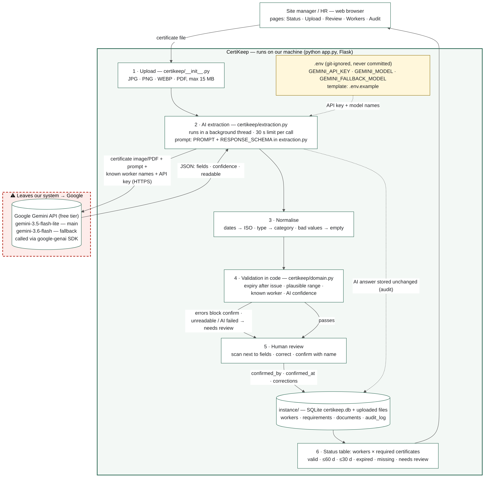
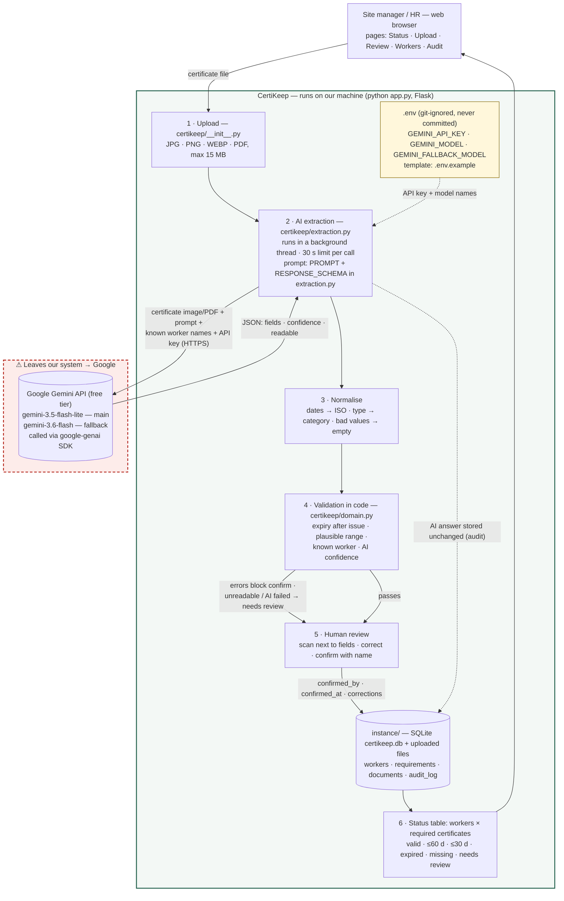

# CertiKeep architecture 

## What happens to one certificate

1. **Upload.** The file is stored in `instance/uploads/` and a document row is created (who uploaded, when).
2. **AI extraction (the AI feature).** The file is sent to Gemini with a fixed JSON schema and the list of known
   worker names. Gemini returns worker name, certificate type, issue date, expiry date, a confidence per field and
   whether the document was readable. It is instructed never to guess or compute values.
3. **Normalise.** Dates are converted to ISO; anything that is not a valid date becomes empty (never a guess).
   The name is linked to a worker only on an exact (order- and accent-insensitive) match.
4. **Validate in code.** Errors block confirmation: no expiry, expiry not after issue, issue in the future,
   implausible dates, unknown worker, no type. Warnings must be looked at: low AI confidence, unreadable document,
   validity longer than 10 years, type "Other".
5. **Human review.** The scan is shown next to the fields. The reviewer corrects values and confirms with their name.
6. **Status.** A certificate is green only after confirmation. Unconfirmed, unreadable or failed extractions show as
   *needs review*. Required certificates with no document show as *missing*.
7. **Audit trail.** Upload, AI answer (kept unchanged), each correction (AI value → confirmed value), confirmation
   and rejection are logged with who and when; exportable as CSV.

## What the diagram shows

| Required | Where |
|---|---|
| User-facing parts, our services, data stores | Browser pages; Flask app steps 1–6; `instance/` (SQLite + files) |
| External API and model by name and version | Google Gemini API: `ggemini-3.5-flash-lite`, fallback `gemini-3.6-flash`, via the `google-genai` SDK |
| Where prompts and model configuration live | Prompt and JSON schema: `PROMPT`, `RESPONSE_SCHEMA` in `certikeep/extraction.py`. Model names: `.env` (defaults in `extraction.py`) |
| Direction of data flow | Arrows |
| Boundary: which data leaves the system, to whom | Red dashed box: certificate image/PDF, prompt and worker names go to Google |
| How secrets are handled | `GEMINI_API_KEY` only in the git-ignored `.env`; `.env.example` is committed without a key |

## Where data goes

| Data | Where | Leaves the machine? |
|---|---|---|
| Certificate files, database, audit log | `instance/` on the machine running the app | No |
| Certificate image/PDF + worker names | Google Gemini API | **Yes**, for extraction only. On the free tier Google may use inputs to improve its products, so only use own, consented or redacted documents. |

## Failure handling

| Failure | What the user sees |
|---|---|
| Blurry photo / unknown layout | AI marks it unreadable → empty fields, *needs review*, banner asking to type the values or reject |
| Gemini error, rate limit, no key | Document saved, banner with the reason, *Run AI again* button, manual entry still possible |
| Gemini overloaded or slow | The upload is not blocked: the read runs in the background with a 30 s limit per call, a second model is tried, and after about 100 s it stops with a banner. Fields can be typed by hand meanwhile |
| AI returns an impossible date | Validation error; cannot be confirmed until corrected |
| Name not in worker list | Not linked; reviewer must pick the worker |
