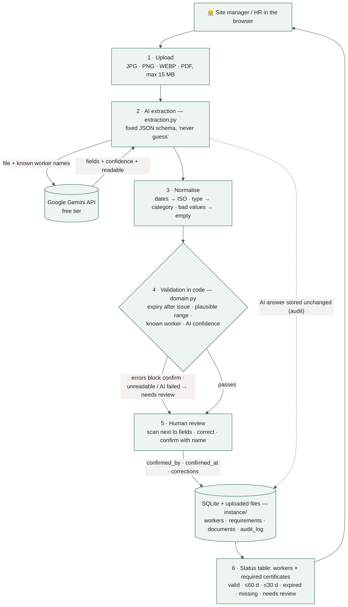
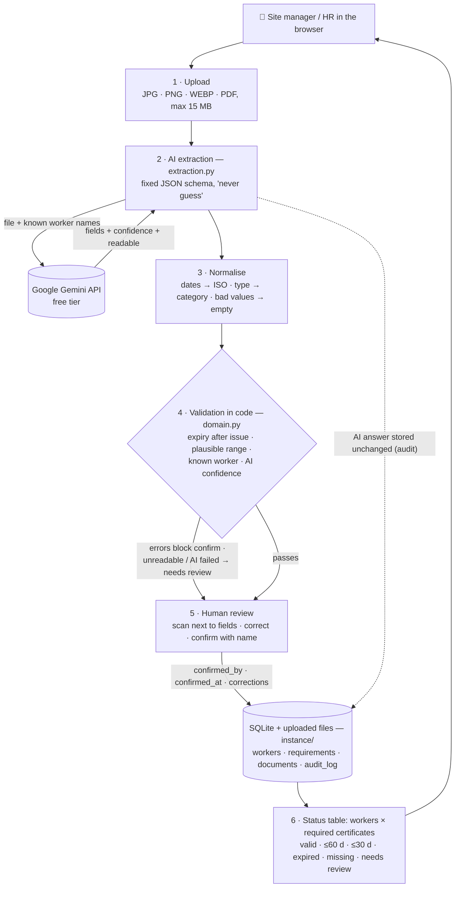

# CertiKeep architecture (M3, tag `m3`)

Source of the image (renders on GitHub):

## What happens to one certificate

1. **Upload.** The file is stored in `instance/uploads/` and a document row is created (who uploaded, when).
2. **AI extraction (the AI feature).** The file is sent to Gemini with a fixed JSON schema and the list of known
   worker names. Gemini returns worker name, certificate type, issue date, expiry date, a confidence per field and
   whether the document was readable. It is instructed never to guess or compute values.
3. **Normalise.** Dates are converted to ISO; anything that is not a valid date becomes empty (never a guess).
   The name is linked to a worker only on an exact (order- and accent-insensitive) match.
4. **Validate in code.** Errors block confirmation: no expiry, expiry not after issue, issue in the future,
   implausible dates, unknown worker, no type. Warnings must be looked at: low AI confidence, unreadable document,
   validity longer than 10 years, type "Other".
5. **Human review.** The scan is shown next to the fields. The reviewer corrects values and confirms with their name.
6. **Status.** A certificate is green only after confirmation. Unconfirmed, unreadable or failed extractions show as
   *needs review*. Required certificates with no document show as *missing*.
7. **Audit trail.** Upload, AI answer (kept unchanged), each correction (AI value → confirmed value), confirmation
   and rejection are logged with who and when; exportable as CSV.

## Where data goes

| Data | Where | Leaves the machine? |
|---|---|---|
| Certificate files, database, audit log | `instance/` on the machine running the app | No |
| Certificate image/PDF + worker names | Google Gemini API | **Yes**, for extraction only. On the free tier Google may use inputs to improve its products, so only use own, consented or redacted documents. |

## Failure handling

| Failure | What the user sees |
|---|---|
| Blurry photo / unknown layout | AI marks it unreadable → empty fields, *needs review*, banner asking to type the values or reject |
| Gemini error, rate limit, no key | Document saved, banner with the reason, *Run AI again* button, manual entry still possible |
| AI returns an impossible date | Validation error; cannot be confirmed until corrected |
| Name not in worker list | Not linked; reviewer must pick the worker |
