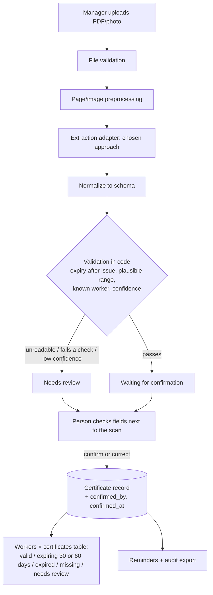

# CertiKeep — technical choice and first MVP plan
**Updated [date] | Initial market: construction firms in Luxembourg with 10+ employees**

**Problem.** Site managers and HSE officers receive certificates (training certificates, licences, medical fitness-for-work certificates) as PDFs, scans and phone photos. CertiKeep extracts the worker name, certificate type and dates, flags missing or expiring certificates and keeps an audit trail. Extracted values are suggestions: a person confirms each one before it counts.

## Two candidate approaches

| Dimension | A. Hosted vision AI (Gemini) | B. Local OCR + rules (Tesseract) |
|---|---|---|
| Output quality | Measured in our experiment (see below) | Measured in our experiment (see below) |
| Cost per unit | Free tier for testing; paid per token in production | No per-request fee; compute and maintenance |
| Latency | Network + model processing | Local processing |
| Data needed | Image + prompt with a fixed JSON schema | Image + language packs + hand-written rules |
| Failure modes | Plausible-looking wrong or invented values; API outage; data leaves our servers | OCR errors on photos; rules miss unseen layouts |
| Vendor lock-in | Medium, reduced by a provider-neutral extraction interface | Low |

## Experiment

**Question:** which approach reads real certificates more reliably?

**Setup.** [N] real or redacted certificates ([describe mix: e.g. 3 medical fitness, 2 first aid, 1 forklift; 4 phone photos, 3 scans, 1 PDF; 1 deliberately blurry]). A person typed what is printed on each document into `experiments/ground_truth.csv` before running the models. Both approaches received the same images. Code: `experiments/` (instructions in `experiments/README.md`).

**Results** (full table in [`experiments/RESULTS.md`](../experiments/RESULTS.md)):

| Metric | Gemini | Tesseract |
|---|---|---|
| Name accuracy | [ ] | [ ] |
| Type accuracy | [ ] | [ ] |
| Issue date accuracy | [ ] | [ ] |
| Expiry date accuracy | [ ] | [ ] |
| **Wrong or invented expiry dates** | [ ] | [ ] |
| Unreadable photo flagged instead of guessed | [ ] | [ ] |
| Average time per document | [ ] | [ ] |

**Decision.** We choose **[Gemini / Tesseract]** because [main reason from the table, e.g. "it read 9/10 expiry dates correctly against 5/10, and the one error was caught by our validation rules"]. [One sentence on what the other approach is still used for, e.g. "Tesseract stays as an offline fallback" or "not used".]

**What the experiment does not show.** [N] documents is a small sample; one document can change the result. We tested only the layouts we had access to.

## Cost estimate — [date]
Experiment: €0 (Gemini free tier, Tesseract is open source, Apache-2.0: https://github.com/tesseract-ocr/tesseract/blob/main/LICENSE).

Production estimate for the chosen approach: [if Gemini: tokens per certificate image from `results/gemini` × current paid price for the model from https://ai.google.dev/gemini-api/docs/pricing; if Tesseract: hosting cost]. Example customer: 40 workers × 4 certificates = 160 documents per year → [€ per customer per year].

## Architecture

Rules implemented in `experiments/validation.py`: a certificate never turns green on the model's word alone; it needs no validation issues **and** a person's confirmation, which is recorded with name and time.

## Limitations and when we would switch
1. Small sample of real documents; layouts from other training providers may behave differently.
2. A correct date can be attached to the wrong field (issue vs expiry). Validation rules catch some of these, human confirmation catches the rest.
3. Extraction cannot establish legal or site compliance; the required certificates per role are configured by the company.

We would switch approach if, on a larger set (≥ 30 documents), the other approach produces fewer wrong or invented expiry dates at an acceptable cost.

## MVP plan

| Task | Owner | Due |
|---|---|---|
| Collect and redact scans, write ground truth | Mattéo | [date] |
| Run Gemini pipeline, tune prompt | Luc | [date] |
| Run Tesseract pipeline, evaluate, write RESULTS.md | Sacha | [date] |
| Two interviews with construction firms each | Sacha, Luc, Mattéo | [date] |
| Exact market numbers from STATEC (Lustat D1301) | Mattéo | [date] |
| Decision + cost estimate in this document | Luc | [date] |
| Review screen: scan next to extracted fields, confirm button (M3) | [owner] | [date] |
| Workers × certificates status table + reminders (M3) | [owner] | [date] |
| Audit export with confirmed_by / confirmed_at (M3) | [owner] | [date] |
